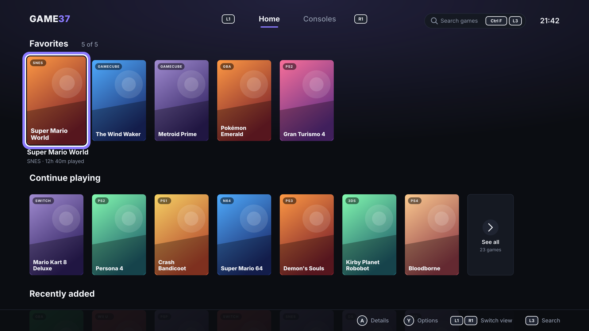
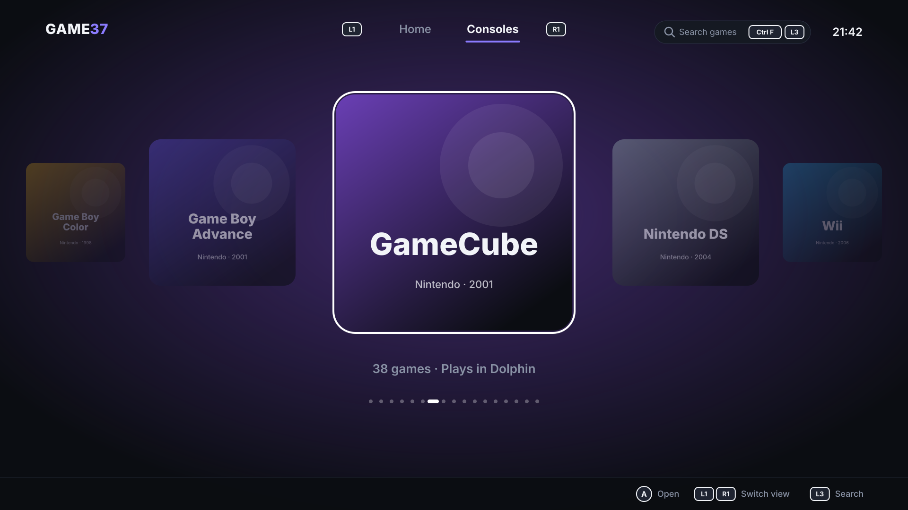

<div align="center">

# Game37

**An all-in-one game library for Nintendo and Sony consoles on Linux**

[](https://github.com/motitschka/Game37/releases)
[](https://github.com/motitschka/Game37/releases)
[](https://github.com/motitschka/Game37/stargazers)
[](https://github.com/motitschka/Game37)


[](LICENSE)


[**Download**](https://github.com/motitschka/Game37/releases) &nbsp;·&nbsp;
[Install](#install) &nbsp;·&nbsp;
[Systems](#systems) &nbsp;·&nbsp;
[Setting up](#setting-up) &nbsp;·&nbsp;
[Known limitations](#known-limitations)

</div>

---

Game37 plays the older Systems itself, from NES to PSP, through libretro Cores inside its own window.
Newer Systems, from GameCube to PS4, are handed to their Standalone Emulators. Drop your games into one
folder and browse them all from a single console-style menu, with a controller or with mouse and
keyboard.

<p align="center">
  
  
</p>

<sub>Design mockups from <code>design/mockups/</code>; the running app follows them closely.</sub>

## Status

**Beta.** Version 0.1.0-beta.1 is the first public release: everything planned for v1 is in, but it has
mostly been played with homebrew and test programs so far. First-run Setup, the library, both ways of
playing, Artwork, the Details Page, the Options Menu, Settings and search all work. Please
[report what breaks](https://github.com/motitschka/Game37/issues).

| Milestone | What it brings | State |
|---|---|---|
| M1 Skeleton | Library scanning, Home and Shelves, Carousel, Console Pages | Done |
| M2 External launching | Standalone Emulators for the 8 newer Systems, Playtime | Done |
| M3 Embedded player | libretro Cores, Pause Menu, Save States, In-game Saves | Done |
| M4 OpenGL rendering | N64, DS, PS1 and PSP inside Game37 | Done |
| M5 Artwork, Details Page, Options Menu | SteamGridDB covers, per-Game page and actions | Done |
| M6 Settings, search, First-run Setup | Everything a new player needs, without editing files | Done |
| M7 Speedrun timer | Your own Splits per Game, LiveSplit-compatible | Planned |

Details are in [docs/milestones.md](docs/milestones.md), and the current state in
[docs/progress.md](docs/progress.md).

## What it does

- **One library for 17 Systems.** Game37 scans one folder per System, cleans up file names into Display
  Titles (`Super Mario World (USA) [!].sfc` becomes "Super Mario World"), and notices added, removed and
  renamed Games while it runs.
- **Home:** four Shelves (Favorites, Continue playing, Recently added, Most played) with up to 20 Games
  each and a "See all" grid.
- **Carousel:** every System in a fixed order, themed per System, opening that System's Console Page:
  a sortable grid of its Games.
- **Retro Systems play inside Game37.** Each Core downloads automatically the first time you play that
  System. You get a Pause Menu, three Save State slots with screenshots, a Resume State written on quit,
  and In-game Saves that are always kept. Up to four controllers are supported, and a keyboard layout
  for playing without one.
- **Newer Systems open in their emulator.** Game37 starts the right Flatpak emulator fullscreen with the
  Game, steps aside while you play, and comes back when the emulator closes. If an emulator isn't
  installed, its System says so and shows the install command.
- **Playtime and last played** are tracked for every Game, embedded and external.
- **Artwork:** with a SteamGridDB API key, Game37 fetches a cover and a wide hero image for each Game
  you browse, caches them, and lets you pick different ones. Without a key, Games show their Display
  Title and System.
- **Details Page:** selecting a Game opens it, with its hero image, Playtime, last played, Save States,
  file and size. Play starts it from there.
- **Options Menu:** on any Game, add it to your five Favorites, start it from a Save State slot, choose
  its Artwork, rename it (the file keeps its name), hide it, or show its file in the file manager.

## Systems

Listed in System Order: Nintendo first, then Sony, each by European release date.

| System | Folder | Played with | Game files |
|---|---|---|---|
| NES | `nes` | Mesen Core | `.nes` `.fds` `.unf` `.unif` |
| Game Boy | `gb` | SameBoy Core | `.gb` |
| SNES | `snes` | bsnes Core | `.sfc` `.smc` |
| Nintendo 64 | `n64` | Mupen64Plus-Next Core | `.n64` `.z64` `.v64` |
| Game Boy Color | `gbc` | SameBoy Core | `.gbc` |
| Game Boy Advance | `gba` | mGBA Core | `.gba` |
| GameCube | `gc` | Dolphin | `.iso` `.gcm` `.rvz` `.ciso` `.gcz` |
| Nintendo DS | `nds` | melonDS DS Core | `.nds` |
| Wii | `wii` | Dolphin | `.iso` `.wbfs` `.rvz` `.wia` `.ciso` `.gcz` |
| 3DS | `3ds` | Azahar | `.3ds` `.cci` `.cxi` `.3dsx` |
| Wii U | `wiiu` | Cemu | `.wua` `.wud` `.wux`, or a game folder with `code/`, `content/` and `meta/` |
| Switch | `switch` | Ryubing | `.nsp` `.xci` `.nro` |
| PlayStation | `ps1` | Beetle PSX HW Core | `.cue` (with its `.bin`) `.chd` `.pbp` `.m3u` |
| PlayStation 2 | `ps2` | PCSX2 | `.iso` `.chd` `.cso` `.zso` |
| PSP | `psp` | PPSSPP Core | `.iso` `.cso` `.pbp` `.chd` |
| PlayStation 3 | `ps3` | RPCS3 | a game folder with `PS3_GAME/`, or with `PARAM.SFO` and `USRDIR/` |
| PlayStation 4 | `ps4` | shadPS4 | a game folder with `eboot.bin` and `sce_sys/` |

Systems played with a Core are **Embedded Systems**; the others are **External Systems**.

## Install

Game37 runs on Linux on x86_64. It's developed on Arch Linux with GNOME on Wayland. The build below is
checked on Arch, Fedora 44, Ubuntu 26.04 LTS and Debian 13 (older releases may not package SDL3), and
the Nix flake with nixpkgs 26.05. Other platforms aren't supported.

There are three ways to get it:

- a [prebuilt binary](#prebuilt-binary-arch-linux-and-ubuntu) for Arch Linux and Ubuntu;
- the [Nix flake](#nixos) on NixOS;
- [building it yourself](#build-from-source) on Arch, Fedora, Ubuntu or Debian.

### What Game37 needs

- **SDL3 and SDL3_ttf**, version 3.2 or newer.
- **OpenGL**, which every desktop has.
- **fontconfig's `fc-match`**, to find the Adwaita Sans font (GNOME's interface font). fontconfig picks
  another font if Adwaita Sans is missing, but Game37 won't start without `fc-match`.
- **Flatpak with Flathub**, for the Standalone Emulators of the External Systems. Embedded Systems don't
  need it.
- **XWayland or an X session**, for PSP only. GNOME has XWayland.

### Prebuilt binary (Arch Linux and Ubuntu)

The binaries use your system's SDL3, so they need an up-to-date Arch (`sudo pacman -Syu`), or Ubuntu
26.04 LTS or newer.

1. Install what Game37 needs.

   **Arch Linux:**

   ```bash
   sudo pacman -S --needed sdl3 sdl3_ttf fontconfig adwaita-fonts flatpak
   ```

   **Ubuntu:**

   ```bash
   sudo apt install libsdl3-0 libsdl3-ttf0 fontconfig flatpak
   ```

2. From the [Releases page](https://github.com/motitschka/Game37/releases), download the file for your
   distribution and its `.sha256` file: `game37-0.1.0-beta.1-x86_64-arch.tar.gz` or
   `game37-0.1.0-beta.1-x86_64-ubuntu.tar.gz`. Then check and unpack it; on Ubuntu, write `ubuntu` in
   place of `arch`:

   ```bash
   sha256sum -c game37-0.1.0-beta.1-x86_64-arch.tar.gz.sha256
   tar -xzf game37-0.1.0-beta.1-x86_64-arch.tar.gz
   ```

3. Set up Flathub, as in [step 3](#3-set-up-flathub) below.
4. Start it:

   ```bash
   ./game37-0.1.0-beta.1/game37
   ```

To start it from your app menu, see [Add Game37 to your app menu](#add-game37-to-your-app-menu); use
`game37-0.1.0-beta.1/game37` in place of `target/release/game37` there.

### NixOS

The prebuilt binaries don't run on NixOS. Use Game37's Nix flake instead. It needs flakes turned on, and
OpenGL and Flatpak in your NixOS configuration. Desktop environments usually turn on OpenGL already:

```nix
nix.settings.experimental-features = [ "nix-command" "flakes" ];
hardware.graphics.enable = true; # OpenGL
services.flatpak.enable = true; # for the External Systems' Standalone Emulators
```

Then set up Flathub, as in [step 3](#3-set-up-flathub) below.

To try Game37 without installing it:

```bash
nix run github:motitschka/Game37/v0.1.0-beta.1
```

To install it, with an entry in your app menu, add the flake to your system flake:

```nix
# flake.nix, under inputs:
game37.url = "github:motitschka/Game37/v0.1.0-beta.1";

# Your NixOS configuration, with inputs passed in through specialArgs:
environment.systemPackages = [ inputs.game37.packages.x86_64-linux.default ];
```

Nix builds Game37 on your machine the first time, which takes a few minutes; there's no binary cache
yet. The libretro Cores Game37 downloads expect a few libraries that NixOS doesn't keep in `/usr/lib`.
The flake loads them into Game37, so Embedded Systems work as on other distributions.

### Build from source

On NixOS, use the [flake](#nixos) instead. The first build takes a few minutes.

#### 1. Install the build tools and libraries

Pick your distribution. Each line also installs Git, fontconfig and Flatpak.

**Arch Linux:**

```bash
sudo pacman -S --needed rust base-devel git sdl3 sdl3_ttf fontconfig adwaita-fonts flatpak
```

**Fedora:**

```bash
sudo dnf install gcc pkgconf-pkg-config git SDL3-devel SDL3_ttf-devel fontconfig flatpak
```

**Debian and Ubuntu:**

```bash
sudo apt install build-essential pkg-config git curl libsdl3-dev libsdl3-ttf-dev fontconfig flatpak
```

#### 2. Install Rust

Game37 needs Rust 1.88 or newer. On Arch, the `rust` package from step 1 is new enough: skip this
step. Elsewhere the distribution's Rust is often older, so install it with rustup, the official
installer, and accept its defaults:

```bash
curl --proto '=https' --tlsv1.2 -sSf https://sh.rustup.rs | sh
```

Then open a new terminal, so `cargo` is on your `PATH`, and check the version:

```bash
cargo --version
```

#### 3. Set up Flathub

The External Systems' Standalone Emulators come from Flathub. If it isn't set up yet, add it once:

```bash
flatpak remote-add --if-not-exists flathub https://dl.flathub.org/repo/flathub.flatpakrepo
```

#### 4. Get the source

```bash
git clone --branch v0.1.0-beta.1 https://github.com/motitschka/Game37.git
cd Game37
```

Leave out `--branch v0.1.0-beta.1` to get the latest development version instead of this release.

#### 5. Build

```bash
cargo build --release
```

The first build downloads the Rust libraries Game37 uses. When it's done, the program is at
`target/release/game37`.

#### 6. Start Game37

```bash
./target/release/game37
```

The first start opens First-run Setup; see [Setting up](#setting-up). F11 switches between window and
fullscreen.

### Add Game37 to your app menu

From the `Game37` folder, copy the program to `~/.local/bin` and add a menu entry for it:

```bash
install -Dm755 target/release/game37 ~/.local/bin/game37
```

```bash
mkdir -p ~/.local/share/applications
```

```bash
cat > ~/.local/share/applications/game37.desktop <<EOF
[Desktop Entry]
Type=Application
Name=Game37
Comment=Play your Nintendo and Sony games
Exec=$HOME/.local/bin/game37
Terminal=false
Categories=Game;Emulator;
EOF
```

Game37 then shows up in your app menu. The program is a single file: everything else it needs is
downloaded or created at first start, in the places listed under
[Where your data lives](#where-your-data-lives).

### Updating

From the `Game37` folder, fetch the new release, check out its tag (shown on the
[Releases page](https://github.com/motitschka/Game37/releases); `v0.1.0-beta.2` is an example) and build
again:

```bash
git fetch --tags
```

```bash
git checkout v0.1.0-beta.2
```

```bash
cargo build --release
```

If you added Game37 to your app menu, run the `install` line from that section again. Your Config,
library, saves and states live outside the `Game37` folder and stay as they are.

### If the build fails

- **It fails at `sdl3-sys` or `sdl3-ttf-sys`, or the last step can't find `-lSDL3` or `-lSDL3_ttf`:**
  the SDL3 or SDL3_ttf development package from step 1 is missing, or older than 3.2.
- **`linker 'cc' not found`, or `cc` missing:** the C compiler from step 1 is missing.
- **Errors about `edition2024`, or compile errors in Game37's own code:** your Rust is probably older
  than 1.88; check with `cargo --version`. Install Rust with rustup (step 2), or run `rustup update` if
  you already use rustup.

## Setting up

Without `~/.config/game37/config.toml`, Game37 opens First-run Setup, which walks through everything a
new player needs:

1. **Pick your Systems:** tick every System you want to play.
2. **Install the emulators:** for each ticked External System, its Standalone Emulator and whether it's
   already installed, and one `flatpak install flathub …` command for the ones that aren't, with a Copy
   button. Passed over if you ticked only Embedded Systems.
3. **Make your folders:** the Games Root, defaulting to `~/Games` (Change lets you pick another), and
   one folder per ticked System plus `bios/`, which this step creates.
4. **Download the Cores** for the Embedded Systems you ticked, from the libretro buildbot.
5. **Optionally add a SteamGridDB API key** for covers and hero images; Ctrl+V pastes it.

Finish writes the Config and opens Home. Nothing before Finish writes it, so quitting Setup early
brings it back next time.

After Setup, or once it's done:

- **Add your games.** Put each game in its System's folder, using the file types from the
  [Systems](#systems) table:
  - Subfolders are fine: `ps1/Final Fantasy VII/…` is found too.
  - A multi-disc PS1 game appears once if you add an `.m3u` playlist that lists its discs.
  - Games copied in while Game37 runs appear without a restart.
- **The PS1 BIOS.** Put one of `scph5500.bin`, `scph5501.bin`, `scph5502.bin`, `scph5503.bin`,
  `scph7003.bin` or `scph5552.bin` in the Games Root's `bios/` folder. Game37 tells you which file is
  missing if there is none, in Settings → BIOS too. No other Embedded System needs a BIOS.
- **Emulators that need files from your own console**, set up inside the emulator itself rather than in
  the Games Root: Switch keys for Ryubing, the PS3 firmware for RPCS3, and the PS4 modules for shadPS4.

The Cores need no further setup beyond Setup's download step: a Core not yet downloaded still downloads
automatically the first time you play its System, with a progress screen.

### Setting up by hand

If you'd rather not go through First-run Setup, write the Config yourself before first starting Game37.
Copy the example; its one setting is the Games Root, which defaults to `~/Games`:

```bash
mkdir -p ~/.config/game37 && cp config.example.toml ~/.config/game37/config.toml
```

Then make the System folders in the Games Root yourself, the same ones Setup's "Make your folders" step
would:

```bash
mkdir -p ~/Games/{nes,gb,snes,n64,gbc,gba,gc,nds,wii,3ds,wiiu,switch,ps1,ps2,psp,ps3,ps4,bios}
```

To add a SteamGridDB API key without using Settings → Artwork, save it where only you can read it:

```bash
install -m 600 /dev/null ~/.config/game37/secrets.toml
```

and put this line in that file:

```toml
steamgriddb_api_key = "your-key-here"
```

Game37 reads the key when it starts; Settings → Artwork is the place to enter or remove it afterwards,
without a restart.

## Settings

Open Settings with Start on a controller, Ctrl+, on the keyboard, or the gear in the top bar. It has
seven sections, down the left:

- **Library:** the Games Root location (Change it), Rescan library, Hidden games (bring one back), and
  Reset Playtime and stats.
- **Artwork:** the SteamGridDB API key, entered or removed; covers and hero images start loading
  without a restart.
- **BIOS:** every System's BIOS status, in System Order.
- **Cores:** Update all, or redownload a single one.
- **Controls:** Menu button style (Nintendo, where the right face button confirms; or Xbox or
  PlayStation, where the bottom face button confirms) and Controller test, which exits by holding B.
- **Display:** Startup window mode (Remember last, Always fullscreen or Always windowed), which applies
  the next time Game37 starts.
- **About:** the version, the licence and the paths Game37 uses.

## Search

Ctrl+F on the keyboard, L3 on a controller, or the search pill in the top bar opens Search. Results
filter live by Display Title across every System, ignoring case and accents. With a controller, you
type on the on-screen keyboard. Hidden Games never show in Search.

## Controls

Menus use Nintendo-style buttons by default: the right face button confirms and the bottom one goes
back; Settings → Controls → Menu button style switches to Xbox or PlayStation layout instead.

| In menus | Controller | Keyboard | Mouse |
|---|---|---|---|
| Move | D-pad | Arrow keys | Point, or scroll the wheel |
| Confirm | Right face button (A) | Enter or Space | Click |
| Back | Bottom face button (B) | Esc or Backspace | Mouse back button |
| Switch between Home and the Carousel | L1 / R1 | Q / E or Tab | Click a tab |
| Open a Game's Options Menu | Left face button (Y) | F | Right-click |
| Change the sort order on a Console Page | Top face button (X) | S | |
| Search | L3 | Ctrl+F | Click the search pill |
| Settings | Start | Ctrl+, | Click the gear |
| Paste, in a text field | | Ctrl+V | |
| Fullscreen | | F11 | |

In an embedded game, buttons map by position to the original console's controller. Controllers become
players 1 to 4 in the order they connect. Without a controller, the keyboard plays like this
(RetroArch's default layout):

| Console button | Key |
|---|---|
| D-pad | Arrow keys |
| A / B / X / Y | X / Z / S / A |
| L / R | Q / W |
| Start / Select | Enter / Right Shift |
| R3 (DS: swap screens) | Tab |

- **Pause Menu:** the Guide button, Select + Start, or Esc. It offers resume, save and load in three
  slots, and quit to the library. Quitting writes a Resume State, so the next launch continues where you
  stopped.
- **Nintendo DS:** one large and one small screen; R3 swaps them. Tap the touch screen with the mouse,
  or with a right-stick cursor.
- **External Systems:** quit with the emulator's own controls, and Game37 comes back to the front.

## Where your data lives

| Path | What's there |
|---|---|
| `~/.config/game37/config.toml` | The Config: your Games Root |
| `~/.config/game37/secrets.toml` | Your SteamGridDB API key. Keep it private (`chmod 600`) |
| `~/Games/bios/` | BIOS files |
| `~/Games/saves/<system>/` | In-game Saves |
| `~/Games/states/<system>/` | Save States and Resume States |
| `~/.local/share/game37/cores/` | Downloaded Cores |
| `~/.local/share/game37/library.db` | The library: Playtime, last played, date added, Favorites, renames, hidden Games, chosen Artwork, sort order |
| `~/.local/share/game37/artwork/` | Cached covers and hero images |

`secrets.toml` only exists once you've added a SteamGridDB API key, from Setup, Settings → Artwork, or
by hand; it sits next to the Config and is kept at mode 600. The menu settings you change in Settings →
Controls and Settings → Display (the button style and the window mode) live in `library.db`, not in the
Config.

All your progress lives in the Games Root, so copying `~/Games` backs up games, saves and states in one
go. Cores and cached Artwork download again if deleted, but back up `library.db` too if you want to keep
your Playtime, Favorites, renames and these settings.

## Privacy

Game37 has no telemetry. It only goes online to download Cores from the libretro build server, and to
fetch Artwork from SteamGridDB when you've added a key: only for the Games you look at, a few requests
a second at most.

## Known limitations

- PSP needs an X display (XWayland on GNOME): the PPSSPP Core doesn't start on Wayland's EGL. Without
  one, Game37 shows a message instead.
- N64 rendering is only confirmed with test programs so far, not with a real game.
- Azahar, Ryubing and shadPS4 stay open in their own game list when a game stops, so Playtime keeps
  counting until you close the emulator's window.
- Two Games in the same folder with the same name but different extensions share their save files.
- Hiding a Game also removes it from Favorites.
- When SteamGridDB has no Artwork for a Game, Game37 remembers that and doesn't ask again unless you
  rename the Game.

## Development

All three checks must pass before a commit:

```bash
cargo test
cargo clippy --all-targets -- -D warnings
cargo fmt --check
```

- `cargo test -- --ignored` runs the tests against real Cores and test ROMs. They read local files from
  `.testdata/`, which is gitignored and never committed.
- `scripts/smoke-screens.sh` renders every screen headless into `target/smoke/` to check for visual
  regressions.
- `python3 design/generate_mockups.py` regenerates the screen mockups in `design/mockups/`.

The specification lives in `docs/`:

- [requirements.md](docs/requirements.md): what Game37 must do.
- [user-stories.md](docs/user-stories.md): the same, from the player's side.
- [milestones.md](docs/milestones.md): the build order.
- [adr/](docs/adr/): the decisions behind the design.
- [CONTEXT.md](CONTEXT.md): the glossary of terms used in code, docs and the interface.

Game37 never includes games, BIOS files, console keys or API keys, and the repository must never contain
any. Use dumps of games and firmware you own.

## License

Copyright (C) 2026 Matei Novotny

Game37 is free software: you can redistribute it and/or modify it under the terms of the GNU General
Public License as published by the Free Software Foundation, either version 3 of the License, or (at
your option) any later version.

Game37 is distributed in the hope that it will be useful, but WITHOUT ANY WARRANTY; without even the
implied warranty of MERCHANTABILITY or FITNESS FOR A PARTICULAR PURPOSE. See the [GNU General Public
License](LICENSE) for more details.

The libretro Cores and Standalone Emulators that Game37 uses are separate projects under their own
licenses. Game37 downloads or starts them, but doesn't ship them.
